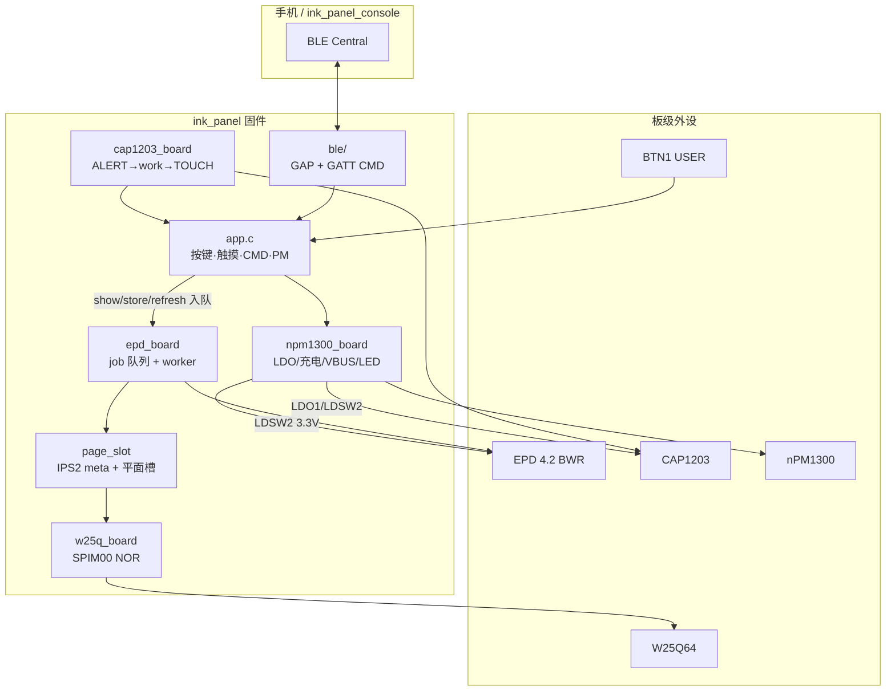
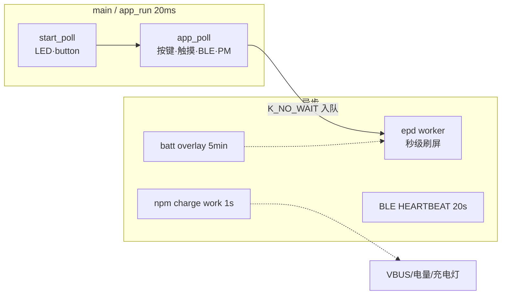
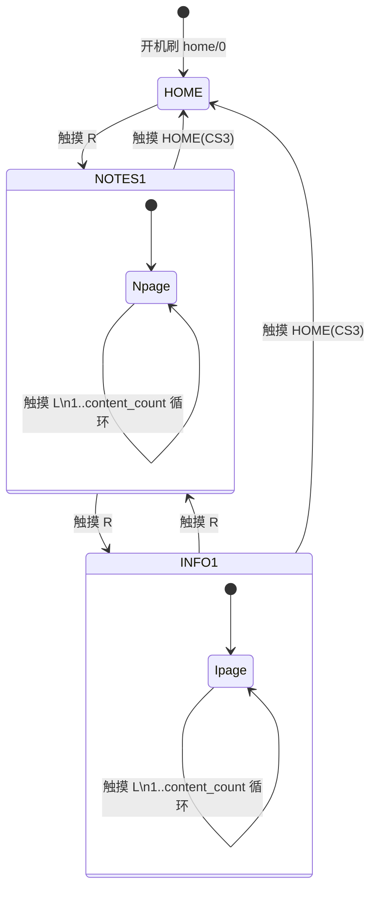
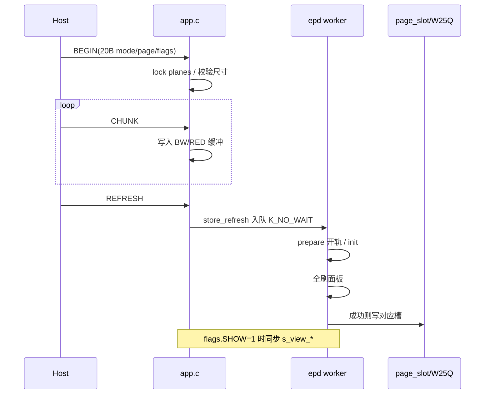
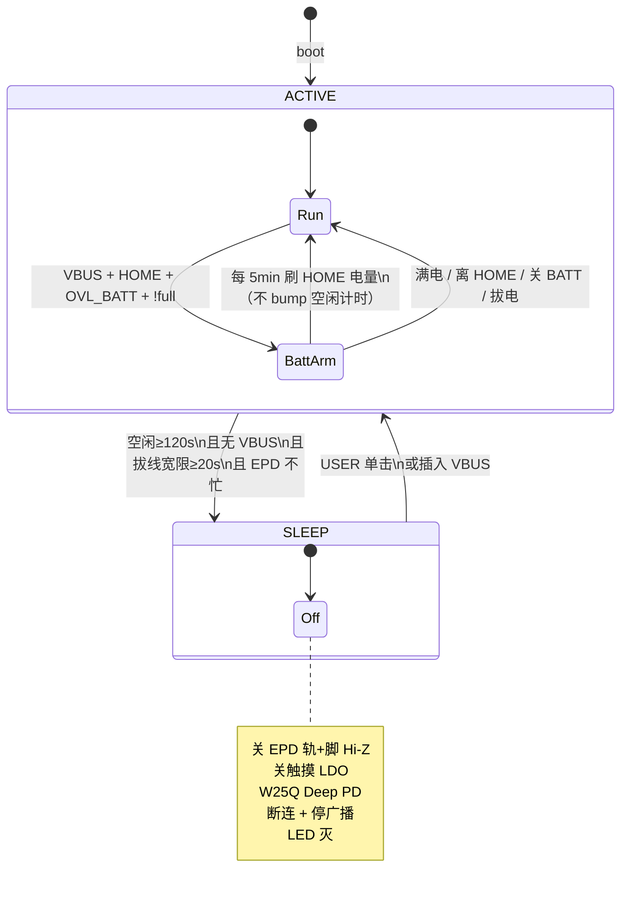
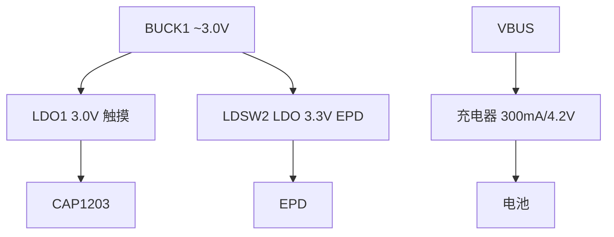

# ink_panel

EVT 自有板。无线链路为 **BLE Peripheral**（仓库 [`ble/`](../../ble/)），支持 **EPD 平面上传**（对齐 `eink_tag` / [`ble/docs/display_plane_upload.md`](../../ble/docs/display_plane_upload.md)）。

**进度页入口** → [`tmp/ink_panel/index.html`](../../tmp/ink_panel/index.html)  
- 最终产品终端 → [`product.html`](../../tmp/ink_panel/product.html)  
- 当前所处阶段 → [`stage.html`](../../tmp/ink_panel/stage.html)  
- 文字说明 → [`PRODUCT.md`](../../tmp/ink_panel/PRODUCT.md)  
- **联调工具（GUI）** → [`tools/ink_panel_console`](../../tools/ink_panel_console)：`python main.py`（关联 [`nrf_console`](../../tools/nrf_console)）

| 层 | 路径 |
|----|------|
| 产品（按键/CMD/会话） | `src/app.c` |
| BLE 协议（仓库共享） | `ble/` via `modules/nrf54_ble` |
| EPD 胶水 | `board/epd_board.*` + `cbb/epd` |
| 进度与终态预览 | `tmp/ink_panel/` |

α / β / γ **DONE**：W25Q 页槽、BEGIN mode/page、CAP1203 L 翻页 / R 切模。  
组 meta（IPS2）：notes/info **page0 不显示**；标题 ≤31 UTF-8；`content_count` 管翻页；连上推 **8002 SLOT_STATUS**。  
软休眠 v1 **DONE**（关外设软睡，非 System OFF）。更后：NFC、字库描字、更深休眠。

## 功能逻辑图（给后来者）

> 下列图为 **产品层认知模型**；细节以 `src/app.c`、`board/*_board.*` 为准。

### 1. 模块与数据流



### 2. 运行时线程与主环



硬约束（与仓库门禁一致）：

- GATT / 按键 ISR / CAP ALERT：**只 ingress**（事件/work），禁止 sleep、刷屏、写 Settings  
- 刷屏只在 **EPD worker**；main 只 `*_request()` 入队  
- 进/出软休眠可阻塞，但须先处理完 busy / 拒新 job

### 3. 本机导航（触摸 + 当前显）



| 输入 | 行为 |
|------|------|
| L | 仅 notes/info；按 `content_count` 翻页；空槽→白屏 |
| R | home→notes@1↔info@1（不再经 R 回 home） |
| HOME | 回 LOGO；已在 home 则忽略 |
| BTN1 单击 ACTIVE | 连上→断连；未连→开广播 |
| BTN1 单击 SLEEP | **唤醒**（不切 BLE） |
| BTN1 长按 5s | `boot_mode=factory` + 冷复位 |

### 4. BLE 平面上传 → 页槽



连上且 TX Notify 开：设备主动推 **8002 SLOT_STATUS**。刷屏中 PING 仍 ACK；BEGIN/CHUNK/REFRESH 忙则 `INVALID_STATE`。

### 5. 软休眠状态机（v1）



进睡顺序（失败则 5s 退避，不动 BLE）：**EPD suspend → CAP → W25Q → 停 BLE**。  
出睡：开 Flash/EPD/CAP → LED 1Hz×4s → 再广播；外设 resume 失败会 `s_wake_incomplete` 在 poll 里重试。  
SLEEP 中触摸/BLE CMD **丢弃**；EPD job **拒入队**（禁止 worker 偷偷开轨）。

### 6. 电源轨（nPM1300）



- 刷屏窗口：`charge_inhibit` 暂关充，减轻与 LDO2 抢电流  
- 产品策略：有 **VBUS 不进软休眠**；充电灯与唤醒灯用 `led_suppress` 仲裁  

## 板级（EVT 网表）

| 功能 | 网名 | 引脚 |
|------|------|------|
| UART TX | `UART_TX` | **P2.02**（手册专用 UARTE TX；**不是**原理图误标的 P2.01） |
| UART RX | `UART_RX` | **P2.00**（UARTE RX；外接 TTL TX；只看日志可不接） |
| LED_STATUS | `LED_STATUS_N` | **P1.13** ACTIVE_LOW |
| BTN1 | `BTN_USER_N` | **P0.00** |
| BTN2 | — | **未接**（勿占用 `TOUCH_ALERT` P0.01） |
| CAP1203 | I2C21 + ALERT | SCL=P1.11 SDA=P1.12；ALERT=**P0.01**；CS1=L / CS2=R |
| BLE 2.4G | — | 片上 RADIO（设备名 `ink_panel`） |
| EPD | — | SCK=P1.08 MOSI=P1.09 CS=P1.10 DC=P1.05 RST=P1.06 BUSY=P1.07 |
| W25Q64 | — | SPIM00：SCK=P2.06 MOSI=P2.08 MISO=P2.09 CS=P2.10（字库/图形预留） |

## 本机 HMI

| 操作 | 行为 |
|------|------|
| 触摸 **L**（CAP1203 CS1） | notes/info 在 **1..content_count** 循环；home / count=0 → 忽略；空槽 → 白屏 |
| 触摸 **R**（CAP1203 CS2） | 切模 **home → notes@1 ↔ info@1**（回 LOGO 用 HOME） |
| 触摸 **HOME**（CS3） | 回 **home/0**；已在 home → 忽略 |
| BTN1 **单击**（ACTIVE） | 已连接 → **断连**（随后自动再广播）；未连接 → **开广播** |
| BTN1 **单击**（SLEEP） | **唤醒**软休眠（开轨+触摸+广播；LED 1Hz×4s） |
| BTN1 **双击** | 预留 |
| BTN1 长按 ≈5s | `boot_mode=factory` + 冷复位（须 slot1 已烧 factory） |

刷屏在 EPD 线程；main 只入队。勿用复位键看日志（会断 J-Link RTT）。  
实验室仍可用 BLE `DISPLAY(2001)` 入队 demo。

## 面板

仅 **4.2" BWR**（WS 4.2" B V2，400×300，平面 15000）。NVS `epanel` 历史值忽略。

## BLE（nRF Connect）

自定义 128-bit 服务（前 32 bit = FNV-1a(NVS sn)），见 [`ble/README.md`](../../ble/README.md)。  
平面协议细节见 [`ble/docs/display_plane_upload.md`](../../ble/docs/display_plane_upload.md)（文档示例多为 2.9；本板默认按 **4.2 / 15000** 传）。

| 步骤 | 期望 |
|------|------|
| 扫描连接 `ink_panel`，对 TX **Enable Notify** | RTT `ble: connected` |
| RX Write：`E9 03 00 00`（PING 1001） | Notify ACK；RTT `app: PING ok` |
| 保持连接约 20s | HEARTBEAT Notify；RTT `app: HEARTBEAT` |
| DISPLAY(2001) | 入队本地 demo；ACK=0 |
| BEGIN/CHUNK/REFRESH（2002–2004） | BEGIN **20B** 带 mode/page；**拒** notes/info page0；CRC 后写指定槽；`flags.bit0=1` 切显 |
| GET_SLOT_STATUS（1002） | 上行 **8002**（73B）+ ACK |
| SET_GROUP_META（4001） | 35B：mode+count+title_len+title[32]；写 meta 后推 8002 |
| 连接后（Notify 开） | 设备主动 **8002 SLOT_STATUS** |
| 刷屏中再发 PING | 仍有 ACK |
| 刷屏中再 BEGIN/CHUNK/REFRESH | ACK `STATUS_INVALID_STATE` |

**不要用** nRF Connect 的 SMP / DFU / UART 菜单测业务。

### 4.2" 上传尺寸（默认）

- `width=400`，`height=300`
- 含 BW/RED 时对应 `len=15000`，CRC32 为整平面

## W25Q 页槽 + 组 meta（IPS2）

| 区 | 说明 |
|----|------|
| meta @0x0 | 4KB：magic=`IPS2`、valid 位图、notes/info 组标题与 `content_count` |
| home×1 + notes×8 + info×4 | 各 32KB；notes/info **page0 物理保留但不作内容页**；空槽刷白 |
| font_cjk @0x69000 | 2MB 预留（不读） |

开机：刷 **home/0**。内容页：home/0；notes **1..7**；info **1..3**。  
Host：`BEGIN(mode,page,flags)` → CHUNK → `REFRESH` 写该槽；组标题/页数用 **4001**。细节见 [`tmp/ink_panel/PRODUCT.md`](../../tmp/ink_panel/PRODUCT.md)。

## 构建 / 烧录

```powershell
.\nrf.cmd -Project ink_panel fullclean
.\nrf.cmd -Project ink_panel build-all
.\nrf.cmd -Project ink_panel flash

# 日常只改 APP：
.\nrf.cmd -Project ink_panel build
.\nrf.cmd -Project ink_panel flash
```

### 发布 0.4.0 / 全新芯片

```powershell
.\nrf.cmd -Project ink_panel release 0.4.0
.\nrf.cmd -Project ink_panel flash
```

归档说明见 [`firmware/0.4.0/README.md`](../../firmware/0.4.0/README.md)。

| 场景 | 烧哪个 |
|------|--------|
| **空白芯片 / 首次量产** | `firmware/0.4.0/nrf54l15_ink_panel_0.4.0_*_unsigned.hex`（merged：MCUBoot+APP） |
| 日常开发 | `.\nrf.cmd -Project ink_panel flash` |
| 不要单独烧空白片 | `.bin`（无 boot） |

期望 RTT：`ink_panel boot` / `ink_panel ok board=...`；异常才有 `epd:` / `npm1300:` 失败行。

## 日志（J-Link RTT）

本工程 **默认不用 UART 控制台**，`printk` 走 **SEGGER RTT**（见 `prj.conf`）：

```conf
CONFIG_USE_SEGGER_RTT=y
CONFIG_RTT_CONSOLE=y
CONFIG_UART_CONSOLE=n
```

须 **J-Link 接好 SWD 且目标在跑**（可先 `flash` 再开 RTT；Viewer 与烧录不要抢同一把锁太久）。

### 方式 A：仓库脚本（推荐）

```powershell
.\tmp\rtt\open_rtt_viewer.cmd
.\tmp\rtt\open_rtt_client.cmd
```

### 方式 B：本机已装 SEGGER J-Link

1. 打开 **J-Link RTT Viewer**
2. Target：`nRF54L15_M33`，SWD
3. 通道 **Terminal 0**

### 注意

| 点 | 说明 |
|----|------|
| 与 UART | `CONFIG_UART_CONSOLE=n`，USB‑TTL **看不到** `printk` |
| 烧录 | 占用 J-Link 时 Viewer 可能断连；烧完再连 |
| 复位键 | 冷复位会断 RTT；BTN1 单击用于断连/再广播 |
| BLE | 须 `CONFIG_START_REQUEST_HFXO=y`（已开） |

墨水屏：`CONFIG_INK_PANEL_EPD=y`；总线默认 **GPIO bitbang**（`CONFIG_INK_PANEL_EPD_SPIM=n`）。实验 SPIM20 当前首次 `spi_write` 会 Bus Fault。

NFC（片内 NFCT）：`CONFIG_INK_PANEL_NFC` 默认工程关；手机验读不在本轮。
